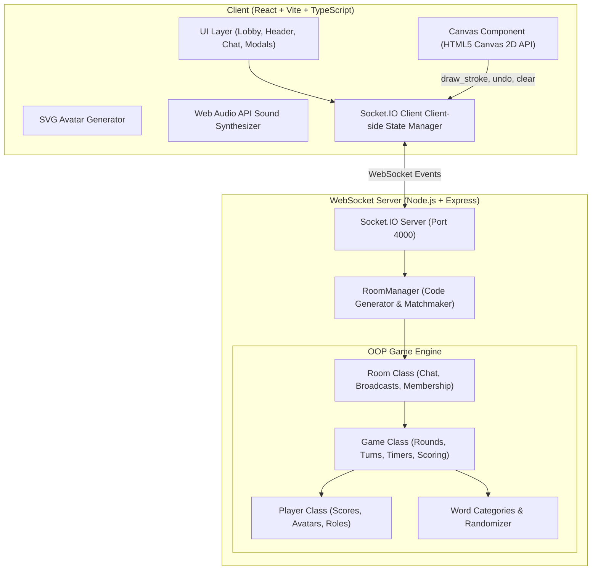
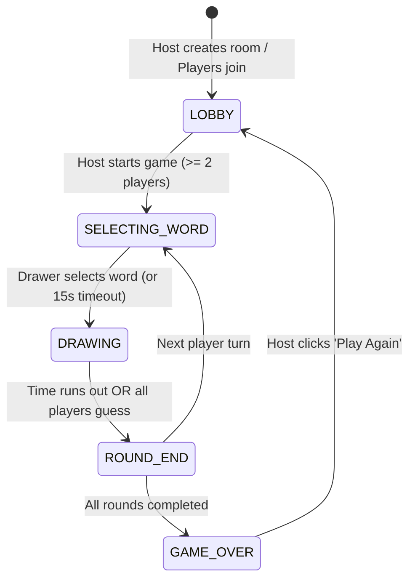

# 🎨 Skribbl.io Clone - Multiplayer Drawing & Guessing Game

A full-stack, real-time multiplayer drawing and guessing game built with **React**, **TypeScript**, **Node.js**, **Express**, and **Socket.IO**. Inspired by skribbl.io, this application features turn-based gameplay, synchronized canvas drawing, real-time guessing with close-guess fuzzy detection, customizable avatars, progressive hints, audio synthesis, and host-configurable game rooms.

---

## 🌟 Live Demo & Deployment

- **Live URL**: https://scribble-clone-h3xi.onrender.com/
- **One-Click Deploy Platforms**: Render, Railway, Fly.io, or Heroku.

---

## 📋 Features & Assignment Checklist

### ✅ Must Have
- **Multiplayer Rooms**: Create and join rooms via unique 6-character room codes or 1-click shareable invite links.
- **Lobby System**: Real-time player roster, player readiness indicators, host controls, and room settings.
- **Turn-based Rounds**: Rotates drawing duties through all players across configurable rounds (2–10 rounds).
- **Real-Time Canvas Sync**: Sub-millisecond stroke synchronization with normalized coordinates (`0.0`–`1.0`) ensuring resolution independence across all devices.
- **Word Selection**: Drawer picks 1 of $N$ words (configurable 1–5 choices) within a 15-second selection window.
- **Guessing & Scoring**: Faster guesses earn higher scores (up to 500 pts); drawers earn bonus points when other players guess their artwork.
- **Leaderboard & Game Over**: Live in-game rankings and game-over podium (1st, 2nd, 3rd) with celebratory confetti.
- **Drawing Tools**: Brush, 22-color palette, 4 brush thicknesses, eraser, undo stroke, and clear canvas.

### ✨ Should Have
- **Progressive Hint System**: Automatically reveals random unrevealed letters over time (e.g. `_ _ a _ _`).
- **Chat & Guess Separation**: In-game chat filters guesses, hides spoilers from unguessed players, and alerts the room when someone guesses correctly.
- **Draw Time Countdown**: Synchronized countdown clock with urgency colors and audio cues for the last 5 seconds.
- **Private & Public Rooms**: Invite-only private rooms with direct link auto-join, plus instant public matchmaking.

### 🚀 Nice to Have & Bonuses
- **OOP Architecture**: Built on clean Object-Oriented design: `RoomManager`, `Room`, `Game`, and `Player` classes.
- **Flood Fill (Bucket Tool)**: Scanline/BFS flood fill algorithm running directly on HTML5 Canvas.
- **Fuzzy Close Guess**: Levenshtein distance matching notifies players when they are 1 letter away (*"You are so close!"*).
- **Word Categories**: 400+ words categorized into Animals, Objects & Tools, Food & Drinks, Actions, and Places & Nature.
- **Custom Word Lists**: Host can supply comma-separated custom words.
- **Avatar Customizer**: Authentic skribbl.io style avatar creator (custom colors, eyes, mouths, and randomizer dice).
- **Synthesized Web Audio**: Sound effects generated natively via the Web Audio API (no external MP3 dependencies).
- **Host Moderation**: Host can kick disruptive players or update room settings.

---

## 🏗️ Architecture Overview

### High-Level System Architecture



### Game State Machine



---

## 📐 Technical Deep Dive & Interview Walkthrough

### 1. How Drawing Strokes Are Captured, Sent, and Rendered
- **Coordinate Normalization**: Client viewport sizes vary across screens (mobile, laptops, 4K monitors). To guarantee consistency, all mouse and touch coordinates are normalized to the range $[0.0, 1.0]$:
  $$x_{\text{norm}} = \frac{x_{\text{client}} - \text{rect.left}}{\text{rect.width}}, \quad y_{\text{norm}} = \frac{y_{\text{client}} - \text{rect.top}}{\text{rect.height}}$$
- **Batching & Interpolation**: While dragging, strokes are accumulated and rendered locally in real-time, then emitted to the server via `draw_stroke`. The server appends the stroke to the room's stroke history and broadcasts it to all peers.
- **Resolution-Independent Rendering**: When clients receive strokes, they multiply the normalized coordinates by their local canvas resolution:
  $$x_{\text{canvas}} = x_{\text{norm}} \times \text{width}, \quad y_{\text{canvas}} = y_{\text{norm}} \times \text{height}$$
- **State Hydration**: When a user joins or reconnects mid-round, the full `strokes` array is transmitted in `room_joined`, allowing instant canvas replay.

### 2. Word Matching & Close Guess Detection
- **Matching Pipeline**: Guesses are sanitized using `trim().toLowerCase()`.
- **Levenshtein Distance**: For words with $\ge 4$ characters, if the guess is not an exact match but has an edit distance of $1$, the server emits a private `close_guess` event to the guesser with an audio and visual alert.
- **Anti-Cheat & Spoilers**:
  - The drawer cannot type the word or substrings of the word in chat.
  - Players who have already guessed can chat freely with each other, but their messages are masked from players who haven't guessed yet.

### 3. Scoring Formula
Points are awarded dynamically based on how quickly a guess is made:
$$\text{Points} = 100 + \left\lfloor 400 \times \max\left(0.1, \frac{t_{\text{left}}}{t_{\text{total}}}\right) \right\rfloor$$
- Maximum points for an instant guess: **500 points**.
- Minimum points for a correct guess before timeout: **140 points**.
- Drawer points: Awarded $\left\lfloor \frac{350}{\text{Guessers}} \right\rfloor$ per correct guesser.

---

## 🚀 Getting Started (Local Development)

### Prerequisites
- **Node.js**: v18.0.0 or higher
- **npm**: v9.0.0 or higher

### Installation & Run

1. **Clone the repository**:
   ```bash
   git clone https://github.com/your-username/skribbl-clone.git
   cd skribbl-clone
   ```

2. **Install all dependencies** (installs root, server, and client via workspaces):
   ```bash
   npm install
   ```

3. **Run both Server and Client in Development Mode**:
   ```bash
   npm run dev
   ```
   - **Frontend**: [http://localhost:3000](http://localhost:3000)
   - **Backend Server**: [http://localhost:4000](http://localhost:4000)

4. **Run End-to-End Test Suite**:
   ```bash
   node server/test-e2e.js
   ```

---

## 🌐 Production Deployment

The project is structured to run as a single unified service or split into separate frontend/backend deployments.

### Single-Service Deployment (e.g. Render / Railway)

1. Build both client and server:
   ```bash
   npm run build
   ```
2. Start the unified production server:
   ```bash
   npm start
   ```
   The Express server serves the static Vite client build from `client/dist` and handles WebSocket connections on the same port!

#### Deploying on Render:
1. Create a **Web Service** pointing to your Git repository.
2. Set **Environment**: `Node`.
3. Set **Build Command**: `npm install && npm run build`.
4. Set **Start Command**: `npm start`.
5. Under **Advanced**, ensure WebSockets are enabled (standard HTTP/1.1 or HTTP/2).

#### Deploying on Railway:
1. Click **New Project** -> **Deploy from GitHub repo**.
2. Railway will automatically detect Node.js.
3. Configure **Build Command**: `npm install && npm run build`.
4. Configure **Start Command**: `npm start`.

---

## 📁 Repository Structure

```text
skribbl-clone/
├── client/                      # React + TypeScript + Vite frontend
│   ├── src/
│   │   ├── components/
│   │   │   ├── Avatar.tsx       # SVG Skribbl-style avatar renderer
│   │   │   ├── AvatarSelector.tsx # Avatar customizer with dice & palette
│   │   │   ├── Canvas.tsx       # HTML5 Canvas with flood fill, undo & tools
│   │   │   ├── ChatBox.tsx      # Real-time chat & guess feedback stream
│   │   │   ├── GameOverModal.tsx# Podium celebration with confetti cannon
│   │   │   ├── Header.tsx       # Timer, rounds, word blanks & audio toggle
│   │   │   ├── Home.tsx         # Welcome screen, public/private join
│   │   │   ├── Lobby.tsx        # Host controls, player cards & settings
│   │   │   ├── PlayerList.tsx   # Live score rankings & drawer badges
│   │   │   ├── RoundEndModal.tsx# Round reveal & score deltas
│   │   │   └── WordModal.tsx    # 3-word drawer selection modal
│   │   ├── audio.ts             # Web Audio API procedural sound engine
│   │   ├── types.ts             # Shared frontend type definitions
│   │   ├── App.tsx              # Main state machine orchestrator
│   │   └── main.tsx             # React DOM root
│   ├── index.html
│   └── vite.config.ts
├── server/                      # Node.js + Express + Socket.IO backend
│   ├── src/
│   │   ├── Game.ts              # Game engine (turns, rounds, timers, hints)
│   │   ├── Player.ts            # Player entity class
│   │   ├── Room.ts              # Room management, broadcast & chat filter
│   │   ├── RoomManager.ts       # Room code generation & matchmaking
│   │   ├── words.ts             # 400+ words across 5 categories
│   │   ├── types.ts             # Server data contracts
│   │   └── index.ts             # Express & Socket.IO server entry point
│   ├── test-e2e.js              # Full automated E2E integration test
│   └── tsconfig.json
├── package.json                 # Monorepo workspaces configuration
└── README.md                    # Project documentation & walkthrough
```
